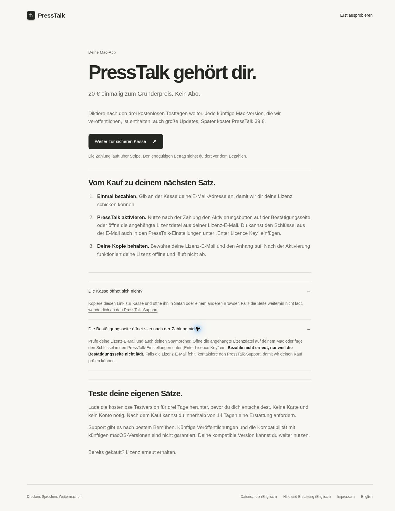

# Checkout recovery and trial-enforcement handoff

Status: 27 October 2026. The website help is live. The native changes in this
branch are a draft pending Mac verification, signing, and a new release.

## Purchase recovery

The reported failure was Chrome's `ERR_QUIC_PROTOCOL_ERROR` at the existing
purchase Worker's `/buy` URL. The error has not been reproduced in this
environment, and its root cause is not established.

The live `/buy` endpoint currently redirects to the existing Stripe Payment Link:

<https://buy.stripe.com/eVq9AU7Egdf55cc345cs80c>

The browser loaded that link's live PressTalk Founder payment form. No payment
was submitted. A supervised retry in Safari or another browser can open this
link directly. This is a customer recovery step, not a permanent automatic
fallback: the public `/buy` route checks sales-enabled state, database readiness,
and Payment Link state before redirecting.

The payment webhook validates the configured Payment Link and Price independently
of whether the buyer visited `/buy`. The licence email includes both an attached
`.presstalk-license` file and a key. A customer can open that attachment on their
Mac or paste the key under Settings → Enter Licence Key. The email's HTML
activation button and Stripe's post-payment redirect still lead to the Worker,
so the attachment/key is the recovery path if the confirmation page fails.
Failure of that page alone is not grounds to submit a second payment.

English and German purchase help was published in commit
`8e3287d00845a45ea39014c0e4fba58a7f4c374f`. Pages run
<https://github.com/subtract0/presstalk/actions/runs/40513822846> succeeded.
The German page was checked in the browser with both help sections expanded.



## What the current trial does

The public download is version 0.1.25, the normal trial build. The trial lasts
72 elapsed hours from the first successful dictation. Earlier installations can
legitimately display `Free (early user)` and retain core dictation. Older public
builds and signed trial extensions have different access behavior.

Continued use alone does not establish a defect. Obtain the customer's app
version, displayed plan label, and approximate first successful dictation time;
do not ask for the full licence key. A paid founder licence displays `Founder`.

Two source defects are corrected in this draft:

1. A successful first delivery recorded its one-time setup flag before starting
   the trial. When unreadable storage deferred the trial start, later deliveries
   returned before retrying. The idempotent start routine now runs before that
   guard and preserves the earliest existing date.
2. A developer entitlement override was accepted in release builds. It is now
   compiled in only for `DEBUG`, with a runtime fixture checking that the
   optimized non-`DEBUG` store rejects it.

Neither finding proves that the affected customer's installation used that
path. Valid signed licences and recorded early-user access are preserved.
Unreadable trial storage still fails open until expiry can be established.
The checkout availability flag is a configured-URL check, not a network probe;
a browser connection failure does not itself extend a trial.

## Mac verification and release

Run from the patched repository root in an Apple Silicon Mac GUI session:

```bash
swift build --disable-sandbox --arch arm64 --product jarvistap
swift test --disable-sandbox --arch arm64 \
  --filter 'EntitlementPolicyTests|TrialAnchorTests|OfflineLicenseStoreTests|AccessLicenseTests'
python3 scripts/test_presstalk_app_wiring.py
bash scripts/test_presstalk_desktop_controls.sh
```

DesktopControls runs both a `DEBUG` variant and an optimized variant without
`DEBUG`. The latter proves that the changed store rejects the development
override. It links existing debug-built core objects and does not replace a
packaged-release check. AppWiring exercises the real delivery method with fake
anchor stores and must cover storage recovery without restarting the trial.

If an already-issued founder acceptance licence is available, include the
signed-licence check without exposing the key in logs or source:

```bash
PRESSTALK_ACCEPTANCE_LICENSE_FILE="/absolute/path/to/acceptance-founder.presstalk-license" \
  bash scripts/test_presstalk_desktop_controls.sh
```

Without that file, signed-licence acceptance is explicitly reported as skipped.
Verify paid access remains `Founder` after reconstructing the store and that an
invalid replacement does not displace a valid licence.

Use the existing `scripts/package_presstalk_release.sh` and release-finisher
workflow with a new version/build and newly prepared manifest. Preserve the
current Developer ID identity and licence public keys. Sign, notarize, staple,
and verify the new artifact; do not reuse a manifest for an older binary.
Then verify the actual packaged release's trial and paid activation behavior
before updating public downloads. Version 0.1.25 remains unchanged until that
release is published.

Checks passed in the Linux editing environment: existing source invariants,
shell/Python runner syntax, and `git diff --check`. Swift compilation, AppKit
runtime fixtures, real signed-licence acceptance, and packaging were not run.

## Required evidence before paid advertising

- A real buyer can open checkout and Stripe confirms the successful payment.
- The corresponding order produces a licence email.
- The buyer activates the licence and can dictate with the paid plan active.
- The normal public purchase route is rechecked on the affected Mac/browser;
  the direct-link recovery alone does not establish that its failure is fixed.
- The trial fixes pass the Mac checks and reach the signed public download.

At this checkpoint, the available Stripe connection exposes only a sandbox,
and this environment has no authenticated Cloudflare deployment or Mac signing
session. Live payment/fulfilment verification and the new Mac release therefore
remain open. Do not report a recovered sale or a released binary from these
source and website checks.
